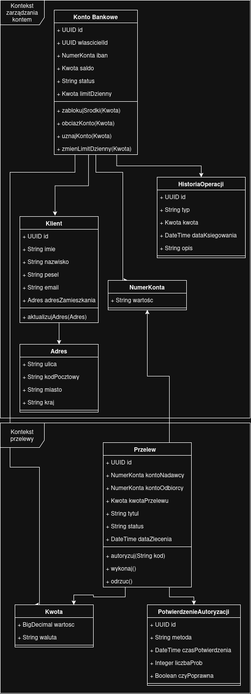

# Zadanie 1 - Domain Driven Design (System Bankowy)

## 1. Opis zadania
Celem niniejszego opracowania jest zamodelowanie wycinka bezpiecznej aplikacji bankowej w oparciu o wzorce taktyczne i strategiczne Domain Driven Design (DDD). Model skupia się na dwóch kluczowych kontekstach ograniczonych: zarządzaniu kontem oraz obsłudze przelewów, celowo pomijając pozostałe obszary bankowości, aby zachować przejrzystość architektury. 

## 2. Diagram modelu

## 3. Zidentyfikowane Bounded Contexts

1. **Kontekst: Zarządzanie Kontem**  
   Odpowiada za prowadzenie rachunków klientów, przechowywanie danych właściciela, kontrolowanie bieżącego salda, weryfikację limitów dziennych oraz rejestrowanie zaksięgowanych operacji.
2. **Kontekst: Przelewy**  
   Odpowiada za proces zlecania, walidacji, silnej autoryzacji (np. 2FA/SMS) oraz realizacji dyspozycji transferu środków pomiędzy rachunkami.

## 4. Przyjęte założenia, encje, obiekty wartości i ograniczenia

### 4.1. Agregaty i Encje

* **KontoBankowe (Aggregate Root - Zarządzanie Kontem)**
  * **Identyfikator:** KontoId (format UUID).
  * **Atrybuty:** wlascicielId (referencja przez ID do encji Klient), iban (NumerKonta), saldo (Kwota), limitDzienny (Kwota), status (Enum: AKTYWNE, ZABLOKOWANE, ZAMKNIETE), lista HistoriaOperacji.
  * **Ograniczenia biznesowe:**
    * Saldo konta nie może spaść poniżej 0.00 (brak obsługi debetu w modelu podstawowym).
    * Operacje obciążenia konta są możliwe wyłącznie wtedy, gdy status == AKTYWNE.
    * Pojedyncza operacja obciążenia nie może przekroczyć wartości limitDzienny.

* **Klient**
  * **Identyfikator:** KlientId (format UUID).
  * **Atrybuty:** imie (2-50 znaków, tylko litery), nazwisko (2-80 znaków), pesel (dokładnie 11 znaków, weryfikacja sumy kontrolnej), adresZamieszkania (Adres), email.
  * **Ograniczenia biznesowe:** Klient musi być osobą pełnoletnią (weryfikowane na podstawie numeru PESEL).

* **HistoriaOperacji (Encja wewnętrzna agregatu KontoBankowe)**
  * **Identyfikator:** OperacjaId (UUID).
  * **Atrybuty:** typ (Enum: UZNANIE, OBCIAZENIE), kwota (Kwota), dataKsiegowania (DateTime), opis (String).
  * **Ograniczenia biznesowe:** Encja jest wyłącznie dopisywana, a więc raz utworzony wpis w historii nie może zostać zmodyfikowany ani usunięty.

* **Przelew (Aggregate Root - Przelewy)**
  * **Identyfikator:** PrzelewId (UUID).
  * **Atrybuty:** kontoNadawcy (NumerKonta), kontoOdbiorcy (NumerKonta), kwotaPrzelewu (Kwota), tytul (string), status (Enum: UTWORZONY, ZAUTORYZOWANY, ZREALIZOWANY, ODRZUCONY), dataZlecenia (DateTime).
  * **Ograniczenia biznesowe:**
    * kontoNadawcy oraz kontoOdbiorcy muszą być różne.
    * Przelew może przejść w stan ZREALIZOWANY wyłącznie ze stanu ZAUTORYZOWANY.
    * Po przejściu w stan ZREALIZOWANY lub ODRZUCONY obiekt staje się niemodyfikowalny.

* **PotwierdzenieAutoryzacji (Encja wewnętrzna agregatu Przelew)**
  * **Identyfikator:** AutoryzacjaId (UUID).
  * **Atrybuty:** metoda (Enum: KOD_SMS, POWIADOMIENIE_PUSH), czasPotwierdzenia, liczbaProb (DateTime), (Integer, maksymalnie 3), czyPoprawna (Boolean).
  * **Ograniczenia biznesowe:** Przekroczenie 3 nieudanych prób autoryzacji automatycznie zmienia status agregatu Przelew na ODRZUCONY.

### 4.2. Obiekty Wartości (Value Objects)

* **Kwota**
  * **Atrybuty:** wartosc (BigDecimal), waluta (np. PLN, EUR).
  * **Format i ograniczenia:** Dokładnie 2 miejsca po przecinku (zaokrąglanie HALF_EVEN), wartość musi być nieujemna (>= 0.00), dla KwotaPrzelewu większa od zera. Operacje dodawania/odejmowania są dozwolone tylko dla tej samej waluty.
* **NumerKonta**
  * **Atrybuty:** wartosc (String).
  * **Format i ograniczenia:** Ciąg 28 znaków dla kont polskich (kod kraju PL + 26 cyfr NRB). Brak spacji i znaków specjalnych.
* **Adres** 
  * **Atrybuty:** ulica (String, do 100 znaków), kodPocztowy (String z weryfikacją poprawności dla kraju), miasto (String, do 60 znaków), kraj (np. PL).

## 5. Operacje i integracja pomiędzy kontekstami (Zdarzenia Domenowe)

1. **Inicjacja i autoryzacja (Przelewy):**
   * Użytkownik tworzy zlecenie przelewu -> powstaje agregat Przelew ze statusem UTWORZONY.
   * Użytkownik zatwierdza operację kodem 2FA poprzez wywołanie metody Przelew.autoryzuj(). Po sukcesie status zmienia się na ZAUTORYZOWANY, a agregat publikuje zdarzenie **PrzelewZautoryzowanyEvent**.
2. **Weryfikacja i obciążenie konta (Zarządzanie Kontem):**
   * Kontekst Zarządzanie Kontem nasłuchuje na PrzelewZautoryzowanyEvent.
   * Wywoływana jest metoda KontoBankowe.obciazKonto(kwota) na rachunku nadawcy:
     * Jeśli konto jest aktywne, kwota mieści się w limicie dziennym i saldo jest wystarczające to saldo zostaje pomniejszone, dodawany jest wpis HistoriaOperacji, a system emituje zdarzenie **KontoObciazoneEvent** (oraz uznaje konto odbiorcy, jeśli należy do tego samego banku).
     * Jeśli warunki nie są spełnione (np. brak środków) to system emituje zdarzenie **ObciazenieOdrzuconeEvent** wraz z powodem.
3. **Finalizacja przelewu (Przelewy):**
   * Po odebraniu KontoObciazoneEvent agregat Przelew zmienia swój status na ZREALIZOWANY.
   * Po odebraniu ObciazenieOdrzuconeEvent agregat Przelew zmienia swój status na ODRZUCONY.